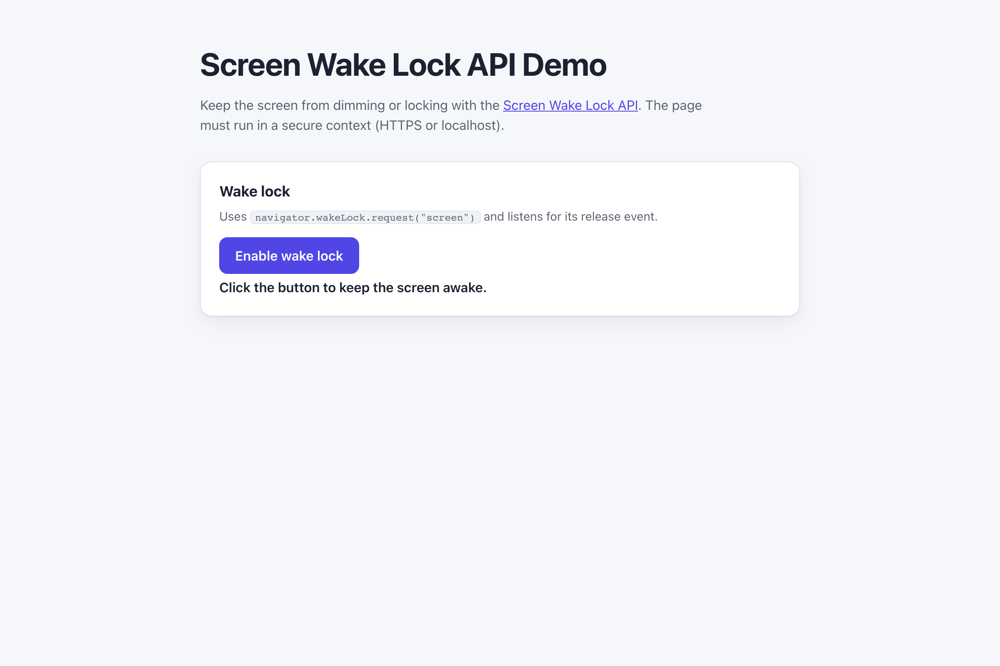

# WebSharper.ScreenWakeLock

[](https://github.com/dotnet-websharper/ScreenWakeLockAPI)

WebSharper bindings for the [Screen Wake Lock API](https://developer.mozilla.org/en-US/docs/Web/API/Screen_Wake_Lock_API) —
keeping the screen from dimming or locking while the page is in use.

The Screen Wake Lock API is only available in [secure contexts](https://developer.mozilla.org/en-US/docs/Web/Security/Defenses/Secure_Contexts)
(HTTPS or localhost), and the user must trigger it with a gesture.

This repository contains:

| Project | Purpose |
| --- | --- |
| `WebSharper.ScreenWakeLock` | The binding: WIG definitions for `WakeLock` and `WakeLockSentinel`. |
| `WebSharper.ScreenWakeLock.Extensions` | `[<Inline>]` client extensions: `navigator.wakeLock` on `Navigator`. |
| `WebSharper.ScreenWakeLock.Sample` | An ASP.NET Core SPA that requests a screen wake lock and reports its state. |

## Live demos

**Try it live:** [Open the sample in your browser](https://dotnet-websharper.github.io/ScreenWakeLockAPI/)



The sample doubles as the binding's test case: it requests a screen wake lock and listens for its release event in a real browser.

- **Sample (this repository):** <https://dotnet-websharper.github.io/ScreenWakeLockAPI/>
- **Source repository:** <https://github.com/dotnet-websharper/ScreenWakeLockAPI>
- **WebSharper bindings:** <https://websharper.com/bindings>

## Features

- `WakeLock` (`request`).
- `WakeLockSentinel` (`released`, `type`, `release`, `onrelease`).
- `navigator.wakeLock` on `Navigator` in the Extensions assembly.

## Installation

The binding is not currently published to NuGet. Reference the projects from source:

```bash
git clone https://github.com/dotnet-websharper/ScreenWakeLockAPI.git
```

```xml
<ItemGroup>
  <ProjectReference Include="path/to/WebSharper.ScreenWakeLock/WebSharper.ScreenWakeLock.fsproj" />
  <ProjectReference Include="path/to/WebSharper.ScreenWakeLock.Extensions/WebSharper.ScreenWakeLock.Extensions.fsproj" />
</ItemGroup>
```

## Usage

```fsharp
namespace WebSharper.ScreenWakeLock.Demo

open WebSharper
open WebSharper.JavaScript
open WebSharper.ScreenWakeLock

[<JavaScript>]
module Demo =
    let requestWakeLock () =
        promise {
            let! sentinel = JS.Window.Navigator.WakeLock.Request("screen")
            sentinel.OnRelease <- fun _ -> Console.Log("Wake lock released")
        }
```

The `navigator.wakeLock` accessor is declared in the Extensions assembly and hangs off `JS.Window.Navigator`.
`request()` returns a `Promise<WakeLockSentinel>`; `release()` releases the lock and `onrelease` fires when it is released.

## Running the sample

Build the sample in Release and serve its static output:

```bash
dotnet build WebSharper.ScreenWakeLock.Sample/WebSharper.ScreenWakeLock.Sample.fsproj -c Release
python3 -m http.server -d WebSharper.ScreenWakeLock.Sample/wwwroot 8203
```

Open <http://localhost:8203/>. Localhost counts as a secure context, so the Screen Wake Lock API is available.

Alternatively, run the ASP.NET Core host:

```bash
dotnet run --project WebSharper.ScreenWakeLock.Sample
```

## Building from source

### Prerequisites

- [.NET SDK 10](https://dotnet.microsoft.com/download) or later.

### Build

```bash
dotnet build WebSharper.ScreenWakeLock.sln -c Release
```

The binding projects target `netstandard2.0`; the sample targets `net10.0`.

## Deployment

Pushing to `main` triggers `.github/workflows/ghpages.yml`, which builds the sample in Release and publishes
`WebSharper.ScreenWakeLock.Sample/wwwroot` to the `gh-pages` branch.

## Repository layout

```
WebSharper.ScreenWakeLock/              # binding (WIG definitions)
  Main.fs
WebSharper.ScreenWakeLock.Extensions/   # [<Inline>] client extensions
  Library.fs
WebSharper.ScreenWakeLock.Sample/       # ASP.NET Core SPA demo
  Client.fs
  Startup.fs
  wwwroot/
    index.html
    site.css
.github/workflows/ghpages.yml           # build + deploy the sample to GitHub Pages
```

## Notes on the API

- **Secure context:** the Screen Wake Lock API is only exposed in secure contexts. Serve the page over HTTPS or
  from localhost.
- **User gesture:** the request must come from a user gesture (for example, a button click).
- **Battery:** a wake lock keeps the screen awake and can drain the battery. Release it when the page is no longer
  visible.
- **Visibility:** the lock is released automatically when the page becomes hidden. Re-request it when the page is
  visible again.
- **Browser support:** support varies by browser. Check the MDN compatibility table before relying on it.

## License

Apache 2.0 — see [LICENSE.md](LICENSE.md).
